# Monorepo Architecture Documentation

## Overview

This repository is a monorepo template built with shadcn/ui, utilizing pnpm for package management and Turbo for build orchestration. It provides a scalable structure for developing multiple applications and shared packages, with a focus on React-based frontend applications using Tailwind CSS v4, Next.js, and a shared UI component library.

The monorepo includes:

- **Apps**: Multiple applications (Authentication and Authorization server, React SPA, Next.js web app, and a placeholder landing page)
- **Services**: Apache APISIX as a service gateway. API gateway is used to route requests to the appropriate backend services (e.g. Auth service, Tracking service and etc.).
- **Packages**: Shared configurations and UI components
- **Tooling**: TypeScript, ESLint, Prettier, and Turbo for efficient development and builds

## Architecture Diagram

```mermaid
graph TD
    A[Root Workspace] --> B[Apps]
    A --> G[Services]
    A --> C[Packages]

    B --> D[be-auth<br/>✅ Express.js Auth Service<br/>✅ Passport.js OAuth]
    B --> Y[be-finance<br/>✅ NestJS Finance Service<br/>✅ Income, Expenses, Assets, Budgets]
    B --> E[react-app<br/>🚧 React SPA<br/>Redux + RTK Query]
    B --> F[web<br/>Next.js App]

    C --> H[backend-core<br/>✅ Consolidated Auth & DB Layer]
    C --> Z[nestjs-common<br/>✅ NestJS Utilities<br/>Guards, Interceptors]
    C --> AA[shared-domain<br/>✅ Domain Models<br/>Zod Schemas, DTOs]
    C --> I[common-dtos<br/>✅ Shared DTOs]
    C --> J[database-entities<br/>✅ DB Schemas]
    C --> K[ui<br/>Shared UI Components]
    C --> L[eslint-config<br/>Shared Linting Rules]
    C --> M[typescript-config<br/>Shared TypeScript Configs]

    D --> H
    D --> I
    D --> J
    Y --> Z
    Y --> AA
    Y --> J
    E --> K
    E --> AA
    F --> K
    G --> R[Apache APISIX<br/>✅ API Gateway]
    G --> S[PostgreSQL<br/>✅ Database Service]

    K --> N[Tailwind CSS v4]
    K --> O[Radix UI Primitives]
    K --> P[Lucide Icons]

    F --> Q[Next.js Framework]
    E --> T[Vite Build Tool]
    E --> BB[Redux Toolkit<br/>State Management]
    E --> CC[Zustand<br/>UI State]
    E --> DD[React Router<br/>Client Routing]
    D --> U[PostgreSQL Client]
    Y --> U
    Y --> EE[NestJS Framework]

    A --> V[Turbo<br/>Build Orchestration]
    A --> W[pnpm<br/>Package Management]
    R --> X[ETCD<br/>Config Store]
```



## Environment Configuration

The monorepo uses a centralized environment configuration approach with all variables defined in the root `.env` file. This ensures consistent configuration across all services and simplifies deployment.

### Key Features

- **Centralized Configuration**: Single `.env` file at the repository root
- **Turbo Integration**: All environment variables declared as global in `turbo.json`
- **Conditional OAuth**: OAuth providers only enabled when valid credentials are provided
- **Development Friendly**: Application works without OAuth setup during development
- **Security First**: Comprehensive documentation of security best practices

### Environment Variables Structure

```bash
# Core Environment
ENVIRONMENT=development
NODE_ENV=development

# APISIX Gateway Configuration
APISIX_ADMIN_URL=http://127.0.0.1:9180
APISIX_ADMIN_KEY=...
APISIX_VIEWER_KEY=...

# Authentication Service
PORT=4001
BASE_URL=http://localhost:4001

# Database Configuration
DB_HOST=localhost
DB_PORT=5432
DB_NAME=shonchoy_auth
DB_USER=postgres
DB_PASSWORD=password

# JWT Configuration
JWT_ACCESS_SECRET=...
JWT_REFRESH_SECRET=...
JWT_ACCESS_EXPIRES_IN=15m
JWT_REFRESH_EXPIRES_IN=7d

# OAuth Providers (Optional)
GOOGLE_CLIENT_ID=your-google-client-id  # Disabled when using placeholder
GOOGLE_CLIENT_SECRET=your-google-client-secret
```

### OAuth Configuration

OAuth providers are conditionally enabled based on environment variables:

- **Development**: OAuth routes are not registered when using placeholder values
- **Production**: OAuth fully enabled when valid provider credentials are configured
- **Security**: Placeholder detection prevents accidental exposure of invalid credentials

## Apps Overview

### React Applications (Focus Areas)

#### react-app (Vite + React SPA) 🚧 **IN PROGRESS**

- **Framework**: React 19 with Vite for fast development and building
- **State Management**: Redux Toolkit for server state, Zustand for UI state
- **Routing**: React Router v6 with protected routes and navigation guards
- **API Integration**: RTK Query for type-safe API calls and caching
- **Styling**: Tailwind CSS v4 for utility-first CSS
- **UI Components**: Consumes the shared `@workspace/ui` package
- **Authentication**: JWT-based auth with token refresh and protected routes
- **Features**: Income management, dashboard, authentication forms, responsive design
- **Port**: Runs on port 3001 in development
- **Purpose**: Main client application for Shonchoy personal finance platform

#### web (Next.js Application)

- **Framework**: Next.js 15 with App Router and Turbopack for development
- **Styling**: Tailwind CSS v4 integrated via the UI package
- **UI Components**: Uses shared components from `@workspace/ui`
- **Features**: Server-side rendering capable, demonstrates the same UI components as react-app but in a Next.js context
- **Themes**: Supports dark/light mode via next-themes
- **Purpose**: Production-ready web application with SSR/SSG capabilities

### Other Apps

#### be-auth (Express.js Auth Service) ✅

- **Framework**: Express.js with TypeScript and Passport.js integration
- **Features**: Complete JWT authentication, OAuth (Google), user management, PostgreSQL integration
- **Security**: bcryptjs password hashing, JWT tokens, OAuth state protection, input validation
- **Authentication**: Passport.js strategies for local login and OAuth providers
- **Database**: PostgreSQL with connection pooling and session management
- **API**: RESTful endpoints with proper error handling and TypeScript interfaces
- **OAuth**: Conditional Google OAuth support (configurable via environment variables)
- **Port**: Runs on port 4001 in development
- **Status**: ✅ Fully functional with APISIX integration and OAuth support

#### be-income (NestJS Income Service) ✅ **NEW**

- **Framework**: NestJS with TypeScript and modular architecture
- **Features**: Complete CRUD operations for income tracking with user isolation
- **Database**: PostgreSQL with TypeORM entities and relationships
- **Authentication**: JWT-based with shared guards and decorators from @workspace/nestjs-common
- **API**: RESTful endpoints with pagination, validation, and error handling
- **Validation**: Zod schemas from @workspace/shared-domain for type safety
- **Port**: Runs on port 3001 in development
- **Status**: ✅ Fully implemented and integrated with APISIX gateway

### Services Overview

#### Apache APISIX (API Gateway) ✅

- **Framework**: Apache APISIX with ETCD configuration store
- **Features**: Load balancing, health checks, rate limiting, and request routing
- **Configuration**: Automatic WSL2 detection and IP configuration
- **Integration**: Routes requests to be-auth service with JWT token validation
- **Dashboard**: Web UI for configuration management at port 9000
- **Status**: ✅ Fully configured and tested with be-auth service

#### PostgreSQL (Database Service) ✅

- **Version**: PostgreSQL 16 with Alpine Linux
- **Features**: User authentication, session management, and data persistence
- **Integration**: Connected to be-auth service with connection pooling
- **Migration**: Automatic table creation via SQL scripts
- **Status**: ✅ Running in Docker with persistent volumes

## Shared Packages

### Authentication Packages ✅

#### @workspace/backend-core - Consolidated Backend Package

- **Purpose**: Consolidated authentication and database layer for Express.js services
- **Contents**: Auth service, user repository, session management, TypeORM config
- **Usage**: Used by be-auth service for complete authentication functionality
- **Status**: ✅ Active and used in production

#### @workspace/nestjs-common - NestJS Shared Utilities ✅ **NEW**

- **Purpose**: Reusable NestJS utilities for consistent service development
- **Contents**: Guards, interceptors, decorators, filters, exception handlers
- **Usage**: Imported by all NestJS microservices for standardized functionality
- **Status**: ✅ Fully implemented and documented

#### @workspace/shared-domain - Domain Models & DTOs ✅ **NEW**

- **Purpose**: Type-safe domain models with validation schemas
- **Contents**: Zod schemas, TypeScript interfaces, DTOs for all domains
- **Usage**: Shared across backend services and frontend for type safety
- **Status**: ✅ Implemented with comprehensive type definitions

#### @workspace/common-dtos - Legacy DTOs

- **Purpose**: Common response types and validation schemas
- **Contents**: Response DTOs, pagination types, email/password validation
- **Usage**: Standardizes API responses across services
- **Status**: ✅ Active but being phased out in favor of shared-domain

#### @workspace/database-entities - Database Schemas

- **Purpose**: Shared database table definitions and types
- **Contents**: User and session entity schemas
- **Usage**: Ensures consistency between database and application code
- **Status**: ✅ Active and used in production

### UI Package (@workspace/ui) - Primary Focus

The UI package is the core shared component library, designed for React applications:

- **Components**: Button, Input, NavigationMenu, Sonner (toast notifications), and more
- **Styling**: Built with Tailwind CSS v4 and class-variance-authority for variant management
- **Primitives**: Uses Radix UI for accessible, unstyled primitives
- **Icons**: Lucide React for consistent iconography
- **Exports**: Modular exports for components, styles, and utilities
- **Architecture**: Follows shadcn/ui patterns with composable, customizable components

Key features:

- **Accessibility**: Radix UI primitives ensure WCAG compliance
- **Theming**: Supports CSS variables for easy customization
- **Performance**: Tree-shakable imports and optimized bundles
- **Developer Experience**: TypeScript support with proper prop types

### Configuration Packages

#### eslint-config

- Provides shared ESLint configurations for different environments (base, Next.js, React, Vite)
- Ensures consistent code quality across the monorepo

#### typescript-config

- Shared TypeScript configurations for base, Next.js, React library, and Vite setups
- Maintains type safety and compilation consistency

## Build and Development Workflows

### Package Management

- **pnpm**: Fast, disk-efficient package manager with workspace support
- **Workspace Configuration**: `pnpm-workspace.yaml` defines package locations

### Build Orchestration

- **Turbo**: Caches builds and runs tasks in parallel
- **Tasks**: build, dev, lint, check-types with proper dependencies
- **Caching**: Intelligent caching of outputs (.next, dist) and inputs

### Development Scripts

- `pnpm dev`: Runs all apps in development mode
- `pnpm dev:auth`: Runs the be-auth service on port 4001
- `pnpm dev:web`: Runs the Next.js web app on port 3000
- `pnpm dev:react`: Runs the React SPA on port 3001
- `docker-compose up -d`: Starts PostgreSQL, APISIX, and ETCD services
- `./scripts/setup-wsl2-apisix.sh`: Configures APISIX for WSL2 environment
- `pnpm build`: Builds all packages and apps
- `pnpm lint`: Lints the entire codebase

## Extending the Monorepo

### Adding New Apps

1. **Create App Directory**:

   ```bash
   mkdir apps/new-app
   cd apps/new-app
   ```

2. **Initialize Package**:

   ```bash
   pnpm init
   ```

3. **Configure package.json**:

   ```json
   {
     "name": "new-app",
     "private": true,
     "scripts": {
       "dev": "vite",
       "build": "vite build",
       "lint": "eslint ."
     },
     "dependencies": {
       "@workspace/ui": "workspace:*"
     },
     "devDependencies": {
       "@workspace/eslint-config": "workspace:*",
       "@workspace/typescript-config": "workspace:*"
     }
   }
   ```

4. **Add Configuration Files**:
   - `tsconfig.json`: Extend from workspace config
   - `vite.config.ts` or `next.config.mjs`: Build configuration
   - `eslint.config.js`: Use workspace ESLint config

5. **Update Turbo (if needed)**:
   - Turbo automatically detects new packages in the workspace
   - Add custom tasks in `turbo.json` if required

6. **Import Shared Packages**:
   ```tsx
   import { Button } from "@workspace/ui/components/button";
   ```

### Adding Components to UI Package

1. **Create Component File**:

   ```bash
   touch packages/ui/src/components/new-component.tsx
   ```

2. **Implement Component**:
   - Follow existing patterns (Radix UI + Tailwind)
   - Export from `packages/ui/src/components/index.ts`

3. **Update Exports**:
   - Add to `package.json` exports if needed

4. **Test in Apps**:
   - Import and use in react-app or web

## CI/CD Pipelines

### GitHub Actions Setup

Create `.github/workflows/ci.yml`:

```yaml
name: CI

on:
  push:
    branches: [main]
  pull_request:
    branches: [main]

jobs:
  lint:
    runs-on: ubuntu-latest
    steps:
      - uses: actions/checkout@v4
      - uses: pnpm/action-setup@v4
        with:
          version: 10.4.1
      - name: Setup Node.js
        uses: actions/setup-node@v4
        with:
          node-version: "20"
          cache: "pnpm"
      - name: Install dependencies
        run: pnpm install
      - name: Lint
        run: pnpm lint

  build:
    runs-on: ubuntu-latest
    steps:
      - uses: actions/checkout@v4
      - uses: pnpm/action-setup@v4
        with:
          version: 10.4.1
      - name: Setup Node.js
        uses: actions/setup-node@v4
        with:
          node-version: "20"
          cache: "pnpm"
      - name: Install dependencies
        run: pnpm install
      - name: Build
        run: pnpm build

  test:
    runs-on: ubuntu-latest
    steps:
      - uses: actions/checkout@v4
      - uses: pnpm/action-setup@v4
        with:
          version: 10.4.1
      - name: Setup Node.js
        uses: actions/setup-node@v4
        with:
          node-version: "20"
          cache: "pnpm"
      - name: Install dependencies
        run: pnpm install
      - name: Run tests
        run: pnpm test # Add test scripts to packages

  deploy-web:
    needs: [lint, build, test]
    runs-on: ubuntu-latest
    if: github.ref == 'refs/heads/main'
    steps:
      - uses: actions/checkout@v4
      - uses: pnpm/action-setup@v4
        with:
          version: 10.4.1
      - name: Setup Node.js
        uses: actions/setup-node@v4
        with:
          node-version: "20"
          cache: "pnpm"
      - name: Install dependencies
        run: pnpm install
      - name: Build web app
        run: pnpm build --filter=web
      - name: Deploy to Vercel
        uses: amondnet/vercel-action@v25
        with:
          vercel-token: ${{ secrets.VERCEL_TOKEN }}
          vercel-args: "--prod"
          vercel-org-id: ${{ secrets.VERCEL_ORG_ID }}
          vercel-project-id: ${{ secrets.VERCEL_PROJECT_ID }}
          working-directory: apps/web

  deploy-api:
    needs: [lint, build, test]
    runs-on: ubuntu-latest
    if: github.ref == 'refs/heads/main'
    steps:
      - uses: actions/checkout@v4
      - uses: pnpm/action-setup@v4
        with:
          version: 10.4.1
      - name: Setup Node.js
        uses: actions/setup-node@v4
        with:
          node-version: "20"
          cache: "pnpm"
      - name: Install dependencies
        run: pnpm install
      - name: Build API
        run: pnpm build --filter=be-auth
      - name: Deploy to Railway
        uses: railwayapp/railway-action@v1
        with:
          railway-token: ${{ secrets.RAILWAY_TOKEN }}
          service: be-auth
```

### Additional Pipeline Suggestions

- **E2E Testing**: Add Playwright or Cypress for end-to-end tests
- **Performance Monitoring**: Integrate Lighthouse CI for performance budgets
- **Security Scanning**: Add Snyk or CodeQL for vulnerability checks
- **Preview Deployments**: Deploy PR branches to preview URLs
- **Release Automation**: Use Changesets for version management and releases

## Best Practices

### Development

- Use workspace versions (`workspace:*`) for internal dependencies
- Follow the established component patterns in the UI package
- Leverage Turbo's caching for faster builds
- Use the shared ESLint and TypeScript configs

### Architecture Decisions

- Keep apps focused on their specific domains
- Use the UI package for all shared components
- Prefer server components in Next.js when possible
- Maintain clear separation between API and frontend concerns

### Performance

- Utilize Next.js App Router for optimal loading
- Implement proper code splitting with dynamic imports
- Use Tailwind's purging for minimal CSS bundles
- Cache API responses appropriately

This architecture provides a solid foundation for scalable React applications with shared UI components, efficient tooling, and automated deployment pipelines.
